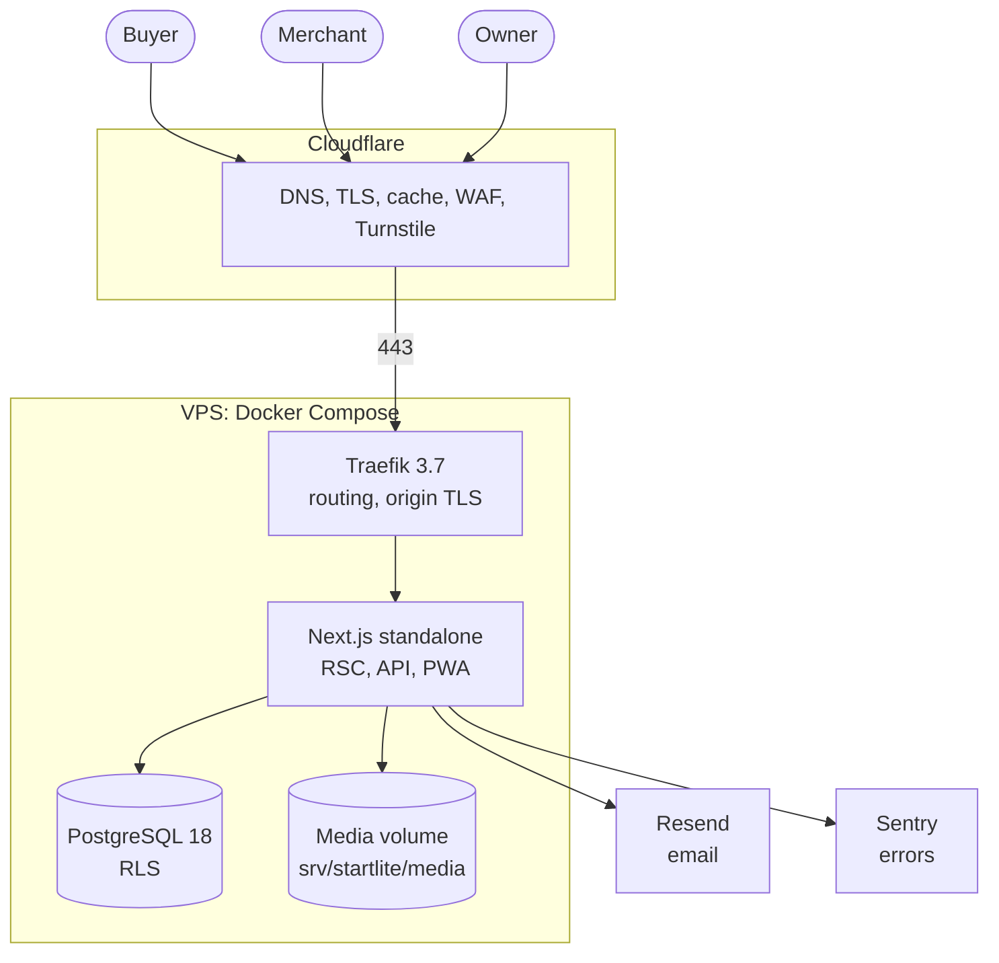
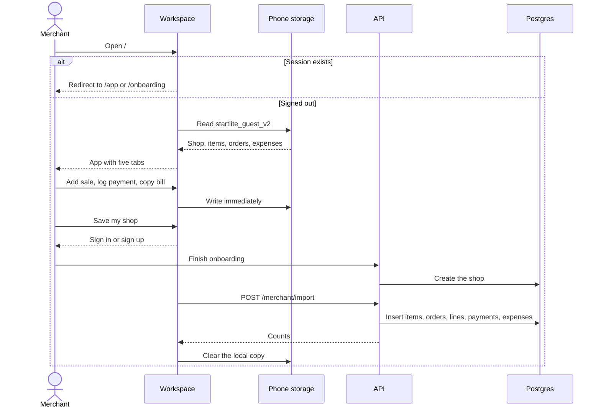
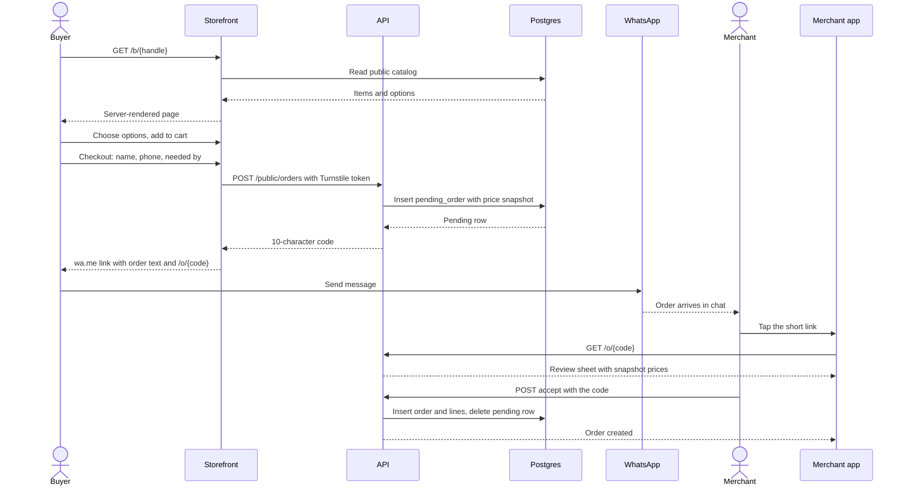
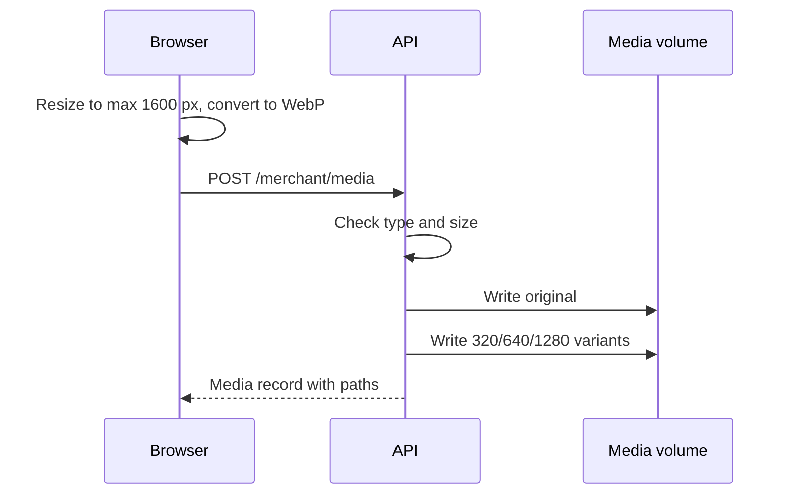

# Architecture

> Part of the StartLite docs. Start at [README](README.md).

- One Next.js app serves every surface.
- Cloudflare sits in front of one VPS.
- A buyer cart lives on the server, not in a link.
- A signed-out merchant works on the phone. Signing in saves and syncs it.

## System shape



**Traefik already runs on the VPS.** StartLite joins its Docker network and adds
router labels. Do not start a second proxy. The setup lives in
[operations.md](operations.md#traefik).

**Trust boundaries.** Cloudflare terminates public TLS. Traefik terminates origin
TLS with a Cloudflare Origin Certificate. Postgres listens only on the Docker
network. Media lives on a mounted volume that only the app can read.

## Rendering strategy

| Route | Rendering | Cache | Auth |
|---|---|---|---|
| `/` | Dynamic workspace shell, client local state | No cache, `noindex` | None. A session redirects to `/app` or `/onboarding`. |
| `/login` | Dynamic | No cache | None. A session redirects. |
| `/b/[handle]` | Server render with tag cache | Cloudflare and Next tag cache | None |
| `/o/[code]` | Server shell, client review | No cache, `noindex` | Merchant session |
| `/app/*` | Server shell, client islands | No HTML cache | Merchant session |
| `/admin/*` | Server render | No cache | Platform admin |
| `/api/v1/*` | Dynamic | No cache | Per endpoint |

Storefront reads use one tag per shop. A catalog or availability write invalidates
that tag in the same request. Cloudflare serves the HTML with
`s-maxage=60, stale-while-revalidate=300`, so a burst of WhatsApp traffic never
reaches the origin.

## Guest workspace



| Rule | Value |
|---|---|
| Scope | One phone, one browser profile |
| Auth | None. The import endpoint requires a session and a shop. |
| Clear | After a successful import, or from More → Start fresh |
| Not included | Storefront hosting, pending orders, PNG receipt, cross-device sync |

The storage key, the stored shape, and the import rules live in
[data-model.md](data-model.md#guest-workspace).

## Flows

### Storefront order



The storefront never calls a merchant endpoint. The only write is the pending
order. The merchant accepts it.

### Order handoff

The buyer's cart becomes a row in `pending_orders`. WhatsApp carries a short
link, not the order itself.

| Rule | Value |
|---|---|
| Code | 10 characters, Crockford base32, random |
| Link | `https://startlite.in/o/{code}` |
| Lifetime | 7 days |
| Payload cap | 32 KB and 50 lines |
| Rate limit | 5 per minute per IP, 20 per hour per shop |
| Bot check | Cloudflare Turnstile, managed mode |
| Price snapshot | Server prices at the moment of the order |
| Review | Mandatory before any order is created |
| Auth | Merchant session, and the code must belong to that shop |
| Unknown code | `404`, with generic preview tags and `noindex` |

A pending order is deleted when the merchant accepts or declines it. A nightly
job deletes the rest after 7 days. Deleted and expired both return `404`, so the
link reveals nothing.

The merchant sees the buyer's snapshot beside the current catalog price. If a
price changed, the review sheet says so. The server recomputes every total. A
tampered price cannot change what is saved.

### Bill

A bill is a message first. An image is optional.

1. The merchant opens an accepted order and taps **Send bill**.
2. The server compiles the bill text from stored snapshots.
3. The merchant taps WhatsApp. `wa.me` opens with the text prefilled.
4. **Generate image** renders a PNG receipt on the client.
5. The PNG is shared as a document, so WhatsApp does not recompress the QR.

The text bill is one message under 4,096 characters. A very long order splits
into a second message with the totals repeated. The image holds the full order.

### Media upload



The app writes the file, so it can validate the bytes before they land. Only one
upload path exists: the API route. There is no presigned URL and no public bucket.

## Payment stack

The stack renders on the final bill and the payment reminder. It never renders at
checkout, because the merchant has not accepted the order yet.

1. **QR.** One QR for the bill total. Built with `uqr` from
   `upi://pay?pa={upiId}&pn={name}&am={amount}&cu=INR`. Values are URL encoded.
2. **Copy UPI ID** and **Copy amount** buttons beside the QR.
3. **Open UPI app.** Best-effort deep link with the same values.
4. **Bank block.** Account name, number, and IFSC. Hidden unless the merchant
   turns it on.

Rules:

- The QR carries the total only. There is no per-line QR.
- When the total exceeds ₹2,000, show: "For ₹2,000 or more, use Copy UPI ID or
  Open UPI App. Bank apps cap gallery-scanned QR codes at ₹2,000."
- The payload never contains a StartLite-controlled VPA.
- The buyer pays the merchant directly. No callback confirms a buyer payment.
  The merchant logs the payment.

## Store settings

Columns, types, and defaults live in
[data-model.md](data-model.md#businesses). This table records the effect of each
setting.

| Setting | Effect |
|---|---|
| `notice_banner` | One line at the top of the storefront |
| `time_precision_default` | The level the request form opens at: `none`, `date`, `period`, `window`, or `exact` |
| `advance_policy_text` | Badge in checkout |
| `address_placeholder` | Input placeholder |
| `privacy_mode` | Bill header becomes "Consultation Receipt" |
| `default_locale` | Initial storefront locale |
| `show_bank_details` | Renders the bank block |

The date label ("Needed by", "Visit on", "From") comes from the pack. There is no
per-business list of times. See
[data-model.md](data-model.md#requested-time).

Buyer auto-memory stores `name`, `phone`, and `note` in `localStorage` under
`startlite_buyer_v1`. Checkout shows "Remembered from last time · Clear".

## Order sources

The source values are defined in
[data-model.md](data-model.md#order-sources). An `opening` order is the only way
paper dues enter the ledger.

## Multi-tenancy and RLS

Roles, the policy pattern, and the required tests live in
[data-model.md](data-model.md#row-level-security). The application rules are:

- Every tenant table carries `business_id`.
- Each transaction starts with
  `SELECT set_config('app.current_business_id', $1, true)`.
- The public storefront resolves a handle to a shop id, then runs the same
  pattern. Public reads touch catalog tables only.
- Pending orders are reachable only with a merchant session for that shop.
- `/admin` uses `startlite_admin` with `BYPASSRLS`, and every action writes to
  `audit_log`.
- The wrapper lives in `lib/tenant.ts`. No route may query a tenant table without
  it.

## Internationalization

| Item | Decision |
|---|---|
| Locales | 24 codes: 22 scheduled languages plus English and Hinglish |
| Live locales | `en`, `hi`, `hi-Latn`, `mr`, `gu`, `ta` |
| Beta locales | The other 18, machine-translated, labelled beta with a report link |
| Selection | Cookie `startlite_locale`, one year, no URL prefix |
| Direction | `rtl` for `ur`, `sd`, and `ks` |
| Numerals | Latin digits, `Intl.NumberFormat('en-IN')` |
| Server | Messages load per request on the server |
| Client | Only the active locale ships to the browser |
| Fonts | Noto family per script by `unicode-range`, active locale only |
| SEO | No `hreflang`, because there are no locale URLs. Set `<html lang>`. |

Storefront locale comes from the shop default and the buyer cookie. Merchant
locale comes from the profile.

## PWA behavior

- Serwist service worker, scope `/app`.
- Precache the app shell and the offline fallback page.
- Data uses network-first with a 3-second timeout.
- No background sync. No offline writes.
- TanStack Query runs with `refetchOnWindowFocus: true` and `staleTime: 30s`.
  This is the "same data on every device" behavior.
- Mutations are optimistic. A failed write rolls back and shows a toast.
- Manifest: `display: standalone`, theme color, maskable icon, `start_url: /app`.
- Safe-area insets are respected on every fixed element.

## Media pipeline

- Files live on the VPS at `/srv/startlite/media`, mounted into the app container.
- One directory per shop: `{business_id}/{kind}/{uuidv7}.{ext}`. Keys never change.
- The browser resizes to 1600 px and converts to WebP before upload.
- The server checks the bytes, then builds 320, 640, and 1280 px variants in WebP
  and AVIF with `sharp`.
- The app serves files at `/media/{key}` with
  `Cache-Control: public, max-age=31536000, immutable`.
- Cloudflare caches `/media/*` at the edge, so repeated views do not reach the VPS.
- The database stores keys and metadata, never bytes.
- Deleting an item soft-deletes its media. A nightly job removes orphan files.

The volume is backed up with the database. It is not a second copy.

## Security

| Control | Implementation |
|---|---|
| Transport | TLS 1.3 at Cloudflare and Traefik, HSTS with preload |
| Origin | Cloudflare Origin Certificate, 15 years, no ACME on the VPS |
| Session | HttpOnly, Secure, SameSite=Lax cookie, 30-day sliding expiry |
| Password | Argon2id through Better Auth |
| CSRF | Origin check plus SameSite cookie |
| Input | Zod at every boundary, strict objects |
| SQL | Parameterized queries only. Drizzle or tagged templates. |
| Headers | CSP with nonce, `X-Content-Type-Options`, `Referrer-Policy`, `Permissions-Policy` |
| Rate limits | See the table below |
| Secrets | Environment only, never in the repository |
| PII in logs | Redact name, phone, address, and note fields |
| Uploads | Single authenticated upload route, MIME check, 5 MB cap, no SVG |
| Disk | LUKS on the VPS volume |
| Admin | Separate database role, every action audited |

| Endpoint group | Limit |
|---|---|
| Auth | 10 requests per minute per IP |
| Public storefront | 120 requests per minute per IP |
| Public order create | 5 per minute per IP, 20 per hour per shop |
| Pending order read | 30 per minute per merchant |
| Media upload | 30 requests per hour per shop |
| Order and payment writes | 60 requests per minute per merchant |

### Accepted risks

| Risk | Mitigation | Revisit when |
|---|---|---|
| PII is plaintext in Postgres | LUKS, RLS, no public database port, redacted logs | Before 1,000 paying merchants |
| A buyer can spam pending orders | Turnstile, per-IP and per-shop limits, small payload cap | If abuse appears |
| Single VPS is a single point of failure | Nightly off-site backups, documented restore | When uptime becomes a paid promise |
| Media shares the VPS disk | Off-box backup, size cap, disk alert at 70% | When media passes 40 GB |
| Beta translations may be wrong | Beta label and report link | When a native reviewer is available |
| Unsaved guest work lives in one browser profile | Save card, import after signup, CSV download | If guest usage grows beyond a trial pattern |

## Performance budgets

| Metric | Budget |
|---|---|
| Storefront JS | Under 100 KB gzip |
| Merchant app shell | Under 200 KB gzip |
| LCP on Slow 4G | Under 2.5 s |
| CLS | Under 0.1 |
| INP | Under 200 ms |
| Lighthouse mobile performance | 90 or higher |
| First-load requests | Under 30 |

CI fails the build when a budget is exceeded.

## Scale model

| Assumption | Value |
|---|---|
| Year-1 shops | 10,000 |
| Orders per shop per month | 20 |
| Orders per month | 200,000 |
| Rows added per year | About 2.4 million orders plus lines and payments |
| Storefront visits per month | 2 million |
| Average cached response | 95% or more |
| Media objects | About 210,000 |
| Media storage | About 25 GB |
| Media egress | Cached by Cloudflare, so the VPS serves few requests |

The database fits on the VPS for several years with correct indexes. Media does
not touch the VPS at all.

## API contract

### Conventions

- Base path `/api/v1`. Auth routes stay under `/api/auth`.
- JSON only, UTF-8.
- Every response carries `requestId`.
- Validation errors return `422`. Auth errors return `401`. Authorization
  errors return `403`. Missing rows return `404`. Conflicts return `409`.
- Client-generated UUIDv7 is the primary key for orders and payments. A repeated
  POST with the same id returns the existing row.

### Endpoints

| Method and path | Auth | Purpose |
|---|---|---|
| `GET /api/health` | Public | Liveness, database reachability, build SHA. Unversioned. |
| `GET /public/store/[handle]` | Public | Shop metadata and nested catalog |
| `POST /public/orders` | Public | Create a pending order. Turnstile required. |
| `POST /auth/sign-up/email` | Public | Create merchant and shop |
| `POST /auth/sign-in/email` | Public | Session cookie |
| `POST /auth/sign-out` | Merchant | End session |
| `POST /auth/request-password-reset` | Public | Send reset mail |
| `POST /auth/reset-password` | Public | Set a new password |
| `POST /auth/verify-otp` | Public | New device or signup check |
| `GET /merchant/bootstrap` | Merchant | Profile, catalog, recent orders, customers, pending count |
| `POST /merchant/import` | Merchant | Copy phone workspace data into the shop. Recomputes totals and skips repeated order codes. |
| `GET /merchant/pending-orders` | Merchant | Unaccepted orders, newest first |
| `GET /merchant/pending-orders/[code]` | Merchant | One pending order for review |
| `POST /merchant/pending-orders/[code]/accept` | Merchant | Create the order and delete the pending row |
| `DELETE /merchant/pending-orders/[code]` | Merchant | Decline |
| `POST /merchant/catalog` | Merchant | Create or update an item with options |
| `PATCH /merchant/catalog/[id]` | Merchant | Update an item |
| `PATCH /merchant/catalog/[id]/availability` | Merchant | Toggle item, option, or extra |
| `DELETE /merchant/catalog/[id]` | Merchant | Soft delete an item |
| `GET /merchant/orders` | Merchant | List with filters |
| `POST /merchant/orders` | Merchant | Walk-in, quote, repeat, manual, opening |
| `PATCH /merchant/orders/[id]` | Merchant | Edit an open tab, status, note, follow-up |
| `POST /merchant/orders/[id]/payments` | Merchant | Log a payment or TDS |
| `GET /merchant/orders/[id]/bill` | Merchant | Bill text and totals |
| `POST /merchant/orders/[id]/reminder` | Merchant | Reminder text for a due bill |
| `GET /merchant/customers` | Merchant | Ledger list, highest pending first |
| `POST /merchant/expenses` | Merchant | Add an expense |
| `GET /merchant/money` | Merchant | Expenses and cash left for a period |
| `GET /merchant/export.csv` | Merchant | Full export, allowed after expiry |
| `POST /merchant/media` | Merchant | Upload one image, build variants |
| `GET /admin/businesses` | Admin | Search and list |
| `POST /admin/businesses/[id]/activate` | Admin | Grant 90 days |
| `POST /admin/businesses/[id]/disable` | Admin | Suspend an account |
| `GET /admin/stats` | Admin | Counts and revenue |

Billing endpoints arrive in v2. V1 activates passes by hand.

### Error envelope

```json
{
  "error": {
    "code": "ORDER_TOTAL_MISMATCH",
    "message": "The order total changed. Review and try again.",
    "details": []
  },
  "requestId": "01J..."
}
```

| Code | Meaning |
|---|---|
| `VALIDATION_FAILED` | Zod rejected the input |
| `AUTH_REQUIRED` | No session |
| `FORBIDDEN` | Session does not own the row |
| `NOT_FOUND` | Row missing, expired, or outside the tenant |
| `CONFLICT` | State machine or uniqueness conflict |
| `TURNSTILE_FAILED` | Bot check did not pass |
| `PAYLOAD_TOO_LARGE` | Order above 32 KB or 50 lines |
| `RATE_LIMITED` | Limit exceeded |
| `PASS_EXPIRED` | The shop has no active pass |

A pending order that expired is `NOT_FOUND`, never `PASS_EXPIRED`.

### Idempotency

- Orders and payments use a client-generated UUIDv7 as the row id.
- A repeated POST with the same id returns the existing row with status `200`.
- A repeated POST with the same id and different content returns `409`.
- Accepting the same pending order twice returns the first order.
