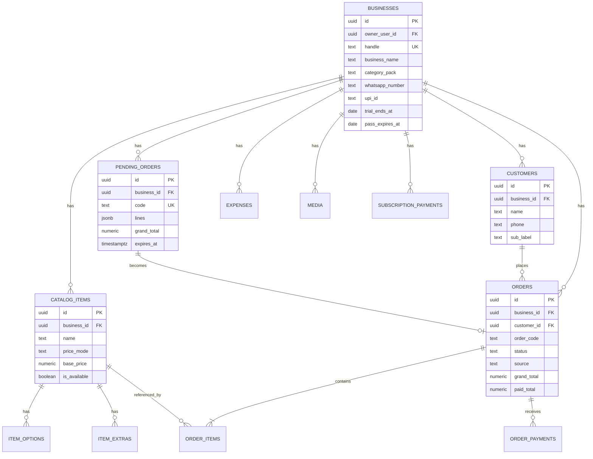
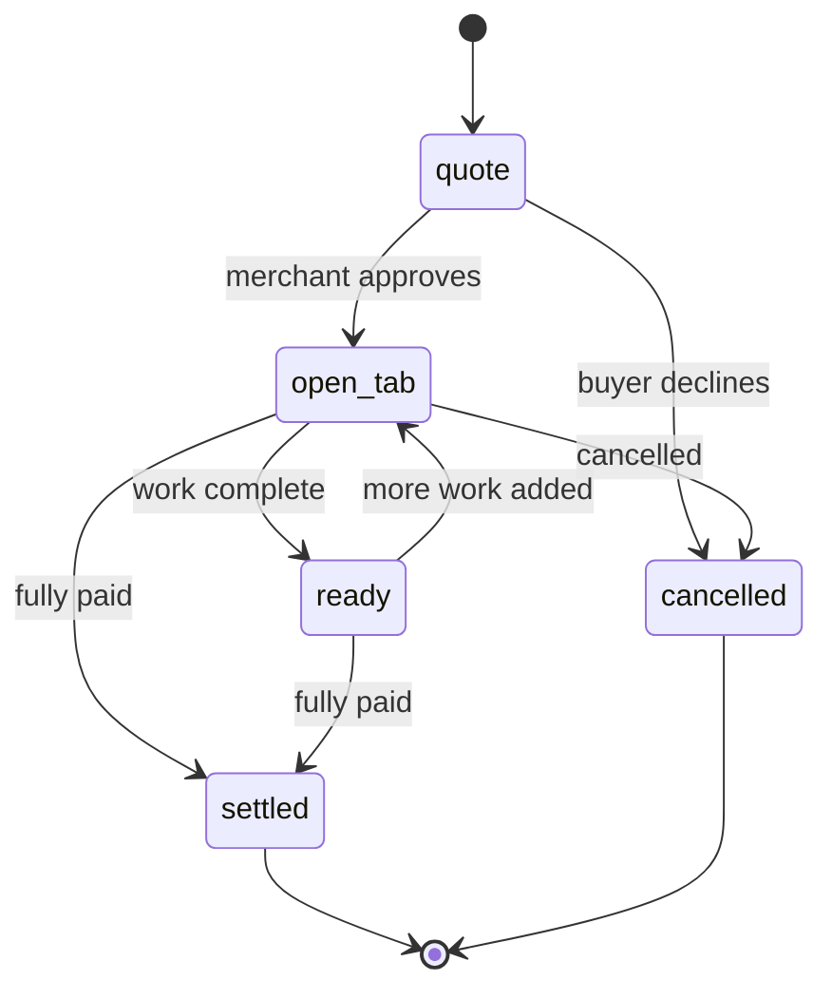
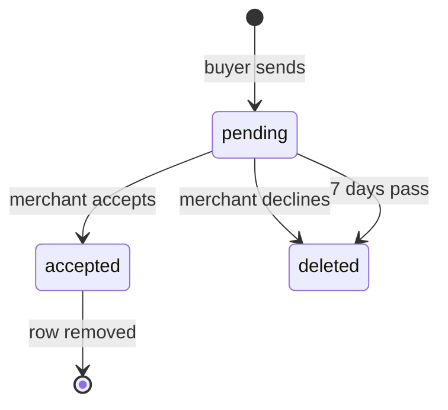

# Data Model

> Part of the StartLite docs. Start at [README](README.md).

- Money is exact. The database and the server always agree.
- A past bill never changes when the catalog changes.
- Every table with shop data is isolated by row-level security.

## Principles

1. Money is `NUMERIC(10,2)`. Quantity is `NUMERIC(10,2)`. The server computes with `decimal.js`. The signed-out workspace uses integer paise and the server recomputes on import.
2. Historical orders keep snapshots. A catalog edit never changes a past bill.
3. Every tenant table carries `business_id` and a row-level security policy.
4. UUIDv7 is the primary key, generated by the server.
5. Timestamps are `TIMESTAMPTZ` in UTC. Dates are `DATE` in IST.
6. Deleting a catalog item is a soft delete. Orders keep their snapshots.
7. A pending order is temporary. It is deleted, never archived.

## Entity relationships



## Tables

### `users`

Better Auth table. Columns: `id`, `email` unique, `email_verified`, `name`,
`password_hash`, `role` (`owner` or `platform_admin`), `locale`, `created_at`,
`updated_at`.

### `sessions`, `accounts`, `verifications`

Owned by Better Auth. Do not change their shape. Session rows carry the user id,
expiry, and an IP hash.

### `businesses`

| Column | Type | Notes |
|---|---|---|
| `id` | UUID | Primary key |
| `owner_user_id` | UUID | One owner per shop in v1 |
| `handle` | TEXT | Unique. Lowercase, 3 to 30 characters, `a-z`, `0-9`, hyphen |
| `business_name` | TEXT | Display name |
| `category_pack` | TEXT | One of the twelve packs in [category-packs.md](category-packs.md) |
| `category` | TEXT | Free text, optional |
| `locality` | TEXT | Free text, optional |
| `tagline` | TEXT | One line |
| `whatsapp_number` | TEXT | E.164 digits, for example `919876543210` |
| `upi_id` | TEXT | VPA, for example `anita@okhdfcbank` |
| `show_bank_details` | BOOLEAN | Default false |
| `bank_account_name` | TEXT | Optional |
| `bank_account_number` | TEXT | Optional, plaintext |
| `bank_ifsc` | TEXT | Optional |
| `default_locale` | TEXT | Default `en` |
| `notice_banner` | TEXT | Optional |
| `enable_time_slots` | BOOLEAN | Default false |
| `advance_policy_text` | TEXT | Optional |
| `address_placeholder` | TEXT | Pack default |
| `privacy_mode` | BOOLEAN | Default false |
| `next_bill_no` | INTEGER | Default 1. The merchant bill serial. Not a GST invoice. |
| `first_item_at` | TIMESTAMPTZ | Set when the first item is published |
| `trial_ends_at` | TIMESTAMPTZ | Default `NOW() + INTERVAL '90 days'` |
| `pass_expires_at` | TIMESTAMPTZ | Null until activated |
| `disabled_at` | TIMESTAMPTZ | Null unless suspended |
| `created_at`, `updated_at` | TIMESTAMPTZ | |

Storefront status is computed: active when `pass_expires_at > NOW()` or
`trial_ends_at > NOW()`, and `disabled_at IS NULL`.

### `platform_settings`

One row for the platform. Only the admin role writes it.

| Column | Type | Notes |
|---|---|---|
| `id` | SMALLINT | Always 1 |
| `legal_name` | TEXT | Registered StartLite entity |
| `gstin` | TEXT | StartLite GSTIN |
| `registered_address` | TEXT | Printed on the tax invoice |
| `sac` | TEXT | `998314` |
| `invoice_prefix` | TEXT | Default `SL` |
| `next_invoice_no` | INTEGER | Global counter for GST invoices |
| `updated_at` | TIMESTAMPTZ | |

### `customers`

| Column | Type | Notes |
|---|---|---|
| `id` | UUID | Primary key |
| `business_id` | UUID | Tenant |
| `name` | TEXT | Required |
| `phone` | TEXT | Nullable. Normalized digits. |
| `sub_label` | TEXT | For example "Rohan - Class 10" |
| `notes` | TEXT | Optional |
| `last_paid_at` | TIMESTAMPTZ | Optional |
| `created_at` | TIMESTAMPTZ | |

Constraint: `UNIQUE (business_id, phone) WHERE phone IS NOT NULL`.

A buyer who gives no phone gets a customer row with `phone = NULL`. Never store a
placeholder number. Two such customers are two rows, because the phone cannot
identify them.

### Catalog

#### `catalog_items`

| Column | Type | Notes |
|---|---|---|
| `id` | UUID | Primary key |
| `business_id` | UUID | Tenant |
| `name` | TEXT | |
| `subtitle` | TEXT | One line |
| `item_type` | TEXT | `product` or `service` |
| `price_mode` | TEXT | `fixed`, `starting_from`, or `quote` |
| `base_price` | NUMERIC(10,2) | Zero for `quote` |
| `unit_label` | TEXT | Display only, for example `kg`, `piece`, `hour` |
| `allow_decimal_qty` | BOOLEAN | Default false |
| `customer_prompt` | TEXT | Optional question for the buyer |
| `ask_whatsapp_media` | BOOLEAN | Default false |
| `is_available` | BOOLEAN | Default true |
| `slots_left` | INTEGER | Nullable, zero or more |
| `image_key` | TEXT | Optional media key |
| `sort_order` | INTEGER | Default 0 |
| `deleted_at` | TIMESTAMPTZ | Soft delete |
| `created_at` | TIMESTAMPTZ | |

`unit_label` is display text. It never drives a calculation.

#### `item_options`

The first level. An option sets the price.

| Column | Type | Notes |
|---|---|---|
| `id` | UUID | Primary key |
| `business_id` | UUID | Tenant |
| `item_id` | UUID | Catalog item |
| `group_label` | TEXT | Default "Option" |
| `name` | TEXT | For example "1 kg" |
| `price` | NUMERIC(10,2) | |
| `is_available` | BOOLEAN | Default true |
| `sort_order` | INTEGER | |

#### `item_extras`

The second level. An extra adds a delta or scopes stock.

| Column | Type | Notes |
|---|---|---|
| `id` | UUID | Primary key |
| `business_id` | UUID | Tenant |
| `item_id` | UUID | Catalog item |
| `parent_option_id` | UUID | Null means it applies to all options |
| `group_label` | TEXT | Default "Extra" |
| `name` | TEXT | For example "Eggless" |
| `price_delta` | NUMERIC(10,2) | Default 0 |
| `is_multi_select` | BOOLEAN | False means radio, true means checkbox |
| `is_available` | BOOLEAN | Default true |
| `sort_order` | INTEGER | |

Two levels only. A third level needs a decision in
[decisions.md](decisions.md#adr-027-two-tier-options-in-v1).

### `media`

| Column | Type | Notes |
|---|---|---|
| `id` | UUID | Primary key |
| `business_id` | UUID | Tenant |
| `kind` | TEXT | `logo` or `item` |
| `catalog_item_id` | UUID | Nullable |
| `object_key` | TEXT | Immutable key |
| `variants` | JSONB | Map of width to key |
| `mime` | TEXT | |
| `width`, `height` | INTEGER | Original size |
| `bytes` | INTEGER | Original size |
| `checksum` | TEXT | SHA-256 |
| `created_at` | TIMESTAMPTZ | |

### `orders`

| Column | Type | Notes |
|---|---|---|
| `id` | UUID | Client-supplied UUIDv7 for idempotency |
| `business_id` | UUID | Tenant |
| `customer_id` | UUID | Nullable |
| `order_code` | TEXT | Human code, for example `ORD-8921` |
| `status` | TEXT | See lifecycle |
| `source` | TEXT | See [order sources](#order-sources) |
| `customer_name` | TEXT | Snapshot |
| `customer_phone` | TEXT | Snapshot, nullable |
| `delivery_note` | TEXT | Snapshot |
| `needed_by` | DATE | Default `CURRENT_DATE`. The UI shows Today, Tomorrow, or a date. |
| `time_slot` | TEXT | `Morning`, `Afternoon`, or `Evening` |
| `follow_up_date` | DATE | Optional |
| `progress_note` | TEXT | For example "4/10 sessions done" |
| `adjustment_amount` | NUMERIC(10,2) | Negative for a discount |
| `adjustment_reason` | TEXT | |
| `revenue_subtotal` | NUMERIC(10,2) | Standard lines plus adjustment |
| `non_revenue_total` | NUMERIC(10,2) | Deposits plus reimbursements |
| `grand_total` | NUMERIC(10,2) | Revenue subtotal plus non-revenue total |
| `paid_total` | NUMERIC(10,2) | Sum of payment amounts |
| `tds_total` | NUMERIC(10,2) | Sum of TDS |
| `bill_no` | TEXT | Nullable. Merchant bill serial, set on first bill. Not a GST invoice. |
| `created_at`, `updated_at` | TIMESTAMPTZ | |

### `pending_orders`

The buyer's cart, held for the merchant to accept.

| Column | Type | Notes |
|---|---|---|
| `id` | UUID | Primary key |
| `business_id` | UUID | Tenant |
| `code` | TEXT | Unique. 10 characters, Crockford base32 |
| `buyer_name` | TEXT | Required |
| `buyer_phone` | TEXT | Required at checkout |
| `needed_by` | DATE | Default `CURRENT_DATE` |
| `time_slot` | TEXT | Optional |
| `note` | TEXT | Optional |
| `lines` | JSONB | Snapshot: item id, name, option, extras, quantity, unit price, line total |
| `revenue_subtotal` | NUMERIC(10,2) | Recomputed at accept |
| `grand_total` | NUMERIC(10,2) | Snapshot shown to the buyer |
| `status` | TEXT | `pending`, or `accepted` for one transaction |
| `accepted_order_id` | UUID | Set on accept |
| `ip_hash` | TEXT | Salted hash, for rate limits only |
| `created_at` | TIMESTAMPTZ | |
| `expires_at` | TIMESTAMPTZ | Default `NOW() + INTERVAL '7 days'` |

Rules:

- A row is deleted on accept, decline, or expiry.
- `lines` is capped at 50 entries and 32 KB.
- Prices in `lines` are a snapshot. The server recomputes at accept.
- No row survives longer than 7 days, so PII has a hard ceiling.

### `order_items`

Immutable snapshots.

| Column | Type | Notes |
|---|---|---|
| `id` | UUID | Primary key |
| `business_id` | UUID | Tenant |
| `order_id` | UUID | |
| `catalog_item_id` | UUID | Nullable, `ON DELETE SET NULL` |
| `line_kind` | TEXT | `standard`, `deposit`, or `reimbursement` |
| `item_name_snapshot` | TEXT | |
| `option_snapshot` | TEXT | |
| `extras_snapshot` | JSONB | Default `[]` |
| `customer_note` | TEXT | |
| `unit_label_snapshot` | TEXT | |
| `quantity` | NUMERIC(10,2) | Greater than zero |
| `unit_price` | NUMERIC(10,2) | Zero or more |
| `line_total` | NUMERIC(10,2) | Generated: `ROUND(quantity * unit_price, 2)` |
| `created_at` | TIMESTAMPTZ | |

### `order_payments`

| Column | Type | Notes |
|---|---|---|
| `id` | UUID | Client-supplied UUIDv7 |
| `business_id` | UUID | Tenant |
| `order_id` | UUID | |
| `amount` | NUMERIC(10,2) | Zero or more |
| `tds_deducted` | NUMERIC(10,2) | Default 0 |
| `payment_mode` | TEXT | `upi`, `cash`, `bank`, or `cheque` |
| `note` | TEXT | |
| `paid_at` | TIMESTAMPTZ | Default now |

Check: `amount > 0 OR tds_deducted > 0`.

Server rule: `SUM(amount) + SUM(tds_deducted)` may not exceed `grand_total`. An
overpayment is rejected with `CONFLICT`.

### `expenses`

`id`, `business_id`, `title`, `amount` (positive), `expense_date`, `created_at`.

### `subscription_payments`

`id`, `business_id`, `invoice_no` (GST serial), `amount_inr` (130.98), `method`
(`manual` in v1), `status` (`created`, `captured`, `failed`), `valid_from`,
`valid_until`, `activated_by`, `note`, `created_at`.

### `audit_log`

`id`, `actor_user_id`, `business_id` (nullable), `action`, `entity`, `entity_id`,
`meta` JSONB, `created_at`. Written for every admin action and every pass
activation.

## Money

| Rule | Detail |
|---|---|
| Storage | `NUMERIC(10,2)` for every amount and quantity |
| Server math | `decimal.js` with `ROUND_HALF_UP` |
| Line total | Postgres generated column, so the database and the server agree |
| Order totals | Recomputed inside one transaction after every item or payment change |
| Deposit and reimbursement | Included in `grand_total`, excluded from revenue |
| Settlement | `paid_total + tds_total >= grand_total` moves the order to `settled` |
| Subscription | 111.00 plus 19.98 GST equals 130.98. Store 130.98. |
| Display | `Intl.NumberFormat('en-IN', { style: 'currency', currency: 'INR' })` |

The API never accepts a computed total from the client. It accepts lines and
quantities, then recomputes.

### Cash left

Cash left is money received minus expenses. It is not profit.

```sql
WITH received AS (
  SELECT order_id, SUM(amount) AS amount
  FROM order_payments
  GROUP BY order_id
),
allocated AS (
  SELECT o.business_id,
         o.id,
         LEAST(GREATEST(o.revenue_subtotal, 0), r.amount) AS revenue_received,
         (SELECT MIN(p.paid_at) FROM order_payments p WHERE p.order_id = o.id) AS first_paid_at
  FROM orders o
  JOIN received r ON r.order_id = o.id
  WHERE o.status <> 'cancelled'
)
SELECT business_id,
       date_trunc('day', first_paid_at) AS day,
       SUM(revenue_received) AS cash_in
FROM allocated
GROUP BY business_id, date_trunc('day', first_paid_at);
```

A payment covers revenue lines first. Any excess covers deposits and
reimbursements, which are not revenue.

Cash left = `SUM(cash_in) - SUM(expenses.amount)` for the same period. The
interface always names the period: Today, This month, or All.

## Order sources

| Source | Meaning | Items |
|---|---|---|
| `whatsapp_store` | Accepted from a pending order | From the snapshot |
| `walk_in` | Counter sale with no name | One or more lines |
| `walk_in` with a free amount | Quick sale | One line named "Sale" |
| `repeated` | Copy of an earlier order | Copied, paid reset to zero |
| `quote` | Estimate | Zero or more lines |
| `manual` | Typed after a call | Zero or more lines |
| `opening` | Previous due from paper | One line named "Previous due" |

`opening` is the only migration path from paper. The merchant enters a name, an
amount, and an optional date. The row behaves like any other order: it appears in
Customers, accepts payments, and appears in the export.

## Guest workspace

A signed-out merchant has the same records without a database. The phone is the
source of truth until signup. The shape is a subset of the server model.

| Phone record | Stored as | Server target on import |
|---|---|---|
| `shop` | One object | `businesses` after onboarding |
| `items` | Array | `catalog_items` |
| `orders` | Array with lines and payments | `orders`, `order_items`, `order_payments` |
| `expenses` | Array | `expenses` |
| `nextBillNo` | Integer | Bill numbers are assigned by the server |

Rules:

1. The key is `startlite_guest_v2`. Unknown fields are dropped on read.
2. Money is an integer paise value in memory and a decimal string at rest.
3. A guest order has a temporary code `G-XXXX`. The code is unique per phone.
4. Customer identity is the phone, else the lowercased name. Nothing is written to
   `customers` until import.
5. `POST /merchant/import` treats every field as untrusted. It recomputes each line
   total, the order total, and the payment sum. An order with payments above its
   total is skipped.
6. The import dedupes on `(business_id, order_code)`. A retry after a dropped
   response writes no duplicate.
7. The phone copy is cleared only after a successful import. A failed import keeps
   the data and offers a retry.
8. The server does not accept a client total. It stores the recomputed value.

## Order lifecycle



Allowed edits:

| Status | Add items | Adjust | Log payment | Change status |
|---|---|---|---|---|
| `quote` | Yes | Yes | Yes | To `open_tab` or `cancelled` |
| `open_tab` | Yes | Yes | Yes | To `ready`, `settled`, or `cancelled` |
| `ready` | Yes | Yes | Yes | To `settled` or `open_tab` |
| `settled` | No | No | No | None |
| `cancelled` | No | No | No | None |

## Pending order lifecycle



Order of operations on accept, in one transaction:

1. Lock the pending row.
2. Recompute totals from current prices.
3. Insert the order and its lines.
4. Delete the pending row.
5. Commit.

A failed step rolls back everything. The merchant can try again.

## Row-level security

Roles:

| Role | Purpose | Attributes |
|---|---|---|
| `startlite_app` | Application traffic | `NOSUPERUSER`, `NOBYPASSRLS` |
| `startlite_admin` | Owner admin | `BYPASSRLS` |
| `startlite_migrator` | Migrations only | Owner of the schema |

Policy pattern, applied to every table with `business_id`:

```sql
ALTER TABLE orders ENABLE ROW LEVEL SECURITY;
ALTER TABLE orders FORCE ROW LEVEL SECURITY;

CREATE POLICY tenant_isolation ON orders
  USING (business_id = NULLIF(current_setting('app.current_business_id', true), '')::uuid)
  WITH CHECK (business_id = NULLIF(current_setting('app.current_business_id', true), '')::uuid);
```

Required tests:

1. Shop A cannot read shop B rows with a raw `SELECT`.
2. Shop A cannot update or delete shop B rows.
3. A transaction without `app.current_business_id` sees zero rows.
4. The admin role sees all rows and writes an audit entry.
5. A public storefront request reads catalog rows for one shop and cannot read
   orders, customers, or pending orders.
6. A merchant cannot read a pending order for another shop.

## Migrations

- Drizzle Kit generates SQL. Review every generated file by hand.
- Migrations run as a one-shot container before the app starts.
- Migrations are forward-only. A rollback is a new forward migration.
- A migration that drops a column needs two releases: stop writing, then drop.
- Seed data lives in `db/seed.ts` and never runs in production.

## Indexes

| Index | Columns |
|---|---|
| Customer lookup | `(business_id, phone) UNIQUE WHERE phone IS NOT NULL` |
| Catalog listing | `(business_id, is_available, sort_order)` |
| Options | `(item_id, sort_order)` |
| Extras | `(item_id, parent_option_id, sort_order)` |
| Order list | `(business_id, status, created_at DESC)` |
| Order items | `(order_id)` |
| Payments | `(order_id)` |
| Pending by shop | `(business_id, created_at DESC)` |
| Pending by code | `(code) UNIQUE` |
| Pending cleanup | `(expires_at)` |
| Expenses | `(business_id, expense_date DESC)` |
| Media | `(business_id, kind)` |
| Audit | `(business_id, created_at DESC)` |

## Retention

| Data | Rule |
|---|---|
| Pending orders | Deleted on accept, decline, or 7 days |
| Orphan media | Deleted after 24 hours with no row |
| Sessions | Expire in 30 days of inactivity |
| Audit log | Kept 24 months |
| Orders and payments | Kept while the account is open |
| Closed account | Tenant rows removed within 30 days of a verified request |
| Backups | Age out in 30 days |

Deleting a shop removes its rows. Backups still hold them until they age out.
The privacy page states this.

## Export

`GET /merchant/export.csv` streams five sections in one file with a UTF-8 byte
order mark.

| Section | Columns |
|---|---|
| Orders | Order code, dates, status, source, customer, phone, totals, adjustment |
| Items | Order code, item, option, extras, quantity, unit price, line total, kind |
| Payments | Order code, amount, TDS, mode, date, note |
| Expenses | Title, amount, date |
| Customers | Name, phone, sub label, pending amount |

The export runs on an expired pass. It never includes another shop's rows. It
never includes pending orders, because they are not orders yet.
