# Operations

> Part of the StartLite docs. Start at [README](README.md).

- One VPS runs the app. Cloudflare runs the edge.
- The VPS never builds an image.
- Every scheduled job is listed in one table.

## Environments

| Environment | Purpose | Data |
|---|---|---|
| Local | Development on a laptop | Docker Postgres, seeded |
| Production | The VPS | Real data, nightly backups |

There is no staging environment in v1. Use a preview deployment from a pull
request when a change is risky.

## Deploy topology

| Service | Image | Port | Notes |
|---|---|---|---|
| `traefik` | `traefik:v3.7.19` | 80, 443 | Already on the VPS. Shared by other apps. |
| `app` | `ghcr.io/<owner>/startlite:<sha>` | 3000, internal | Next.js standalone |
| `migrate` | Same image | None | One-shot, runs before `app` |
| `postgres` | `postgres:18` | 5432, internal | Named volume |
| `media` | Host folder | None | `/srv/startlite/media`, mounted into `app` |

Media lives on the VPS disk at `/srv/startlite/media`. Only Traefik publishes a
port. Postgres listens on the private Docker network.

## Traefik

Traefik already serves other apps on this VPS. StartLite joins it. Do not start a
second proxy and do not edit routes that belong to another app.

| Item | Value |
|---|---|
| Network | `startlite` Docker network, plus the Traefik network |
| Entry points | `web` on 80, `websecure` on 443 |
| TLS | Cloudflare Origin Certificate, 15 years, no ACME |
| Cert files | `/srv/startlite/certs/origin.pem` and `origin-key.pem`, mode 600 |
| Provider | Docker, exposed by default off |
| Logs | JSON access log, 10 MB × 3 |
| Dashboard | Off in production |

Router labels on the `app` service:

```yaml
labels:
  - traefik.enable=true
  - traefik.docker.network=traefik
  - traefik.http.routers.startlite.rule=Host(`startlite.in`) || Host(`www.startlite.in`)
  - traefik.http.routers.startlite.entrypoints=websecure
  - traefik.http.routers.startlite.tls=true
  - traefik.http.routers.startlite.middlewares=startlite-headers@file
  - traefik.http.services.startlite.loadbalancer.server.port=3000
```

The shared static config keeps `web` on a permanent redirect, so Cloudflare always
talks TLS to the origin:

```yaml
# /srv/traefik/traefik.yml, owned by the VPS, not by StartLite
entryPoints:
  web:
    address: ":80"
    http:
      redirections:
        entryPoint:
          to: websecure
          scheme: https
          permanent: true
  websecure:
    address: ":443"
providers:
  docker:
    exposedByDefault: false
    network: traefik
  file:
    directory: /srv/traefik/dynamic
```

Security headers live in `dynamic.yml` as `startlite-headers`. Keep the header
values in one place so the app and the proxy cannot disagree.

Cloudflare connects from its own ranges. Close 443 to everything else:

```bash
# ufw
for ip in $(curl -s https://www.cloudflare.com/ips-v4); do
  ufw allow from "$ip" to any port 443 proto tcp
done
ufw deny 443/tcp
```

Re-run this when Cloudflare publishes a new range. Add it to the quarterly
checklist.

## CI/CD

```mermaid
flowchart LR
    A[Push or pull request] --> B[Lint, typecheck, unit tests]
    B --> C[Integration: RLS and money]
    C --> D[Build Docker image]
    D --> E[E2E on the built image]
    E --> F[Push to GHCR]
    F --> G[VPS pulls image]
    G --> H[Run migrations]
    H --> I[Restart app]
    I --> J[Health check]
    J -->|fail| K[Roll back to previous tag]
```



Pipeline rules:

1. A pull request must pass every gate before merge.
2. A merge to `main` builds and pushes an image tagged with the commit SHA.
3. Deploy pulls a specific SHA. Never deploy `latest`.
4. Migrations run in a separate container and finish before the app restarts.
5. A failed health check restores the previous image tag automatically.
6. Two consecutive failed deploys page the owner.

## Secrets

| Secret | Where |
|---|---|
| `DATABASE_URL`, `ADMIN_DATABASE_URL` | GitHub Environment, copied to `/srv/startlite/.env` with mode 600 |
| `SESSION_SECRET` | Generated once, 32 bytes, stored in the password manager |
| `MEDIA_ROOT` | Same as the database |
| `RESEND_API_KEY`, `MAIL_FROM` | Same |
| `TURNSTILE_SECRET_KEY` | Same |
| `CRON_SECRET` | Same |
| `SENTRY_DSN` | Same |
| SSH key | Owner laptop only, passphrase protected |

Do not put a secret in a Dockerfile, a build argument, the repository, or a log
line. Rotate a secret after any suspected exposure.

## VPS baseline

| Item | Setting |
|---|---|
| OS | Debian 12 or Ubuntu 24.04 LTS |
| CPU and RAM | 2 vCPU, 4 GB |
| Disk | 80 GB SSD |
| Swap | 4 GB file, `vm.swappiness=10` |
| Firewall | UFW allows 22, and 443 from Cloudflare ranges only |
| SSH | Key only, root login disabled, `PasswordAuthentication no` |
| Users | `deploy` with sudo, `startlite` without sudo |
| Updates | `unattended-upgrades` for security patches |
| Docker | Latest stable, log driver `json-file`, `max-size=10m`, `max-file=3` |
| Time | `Asia/Kolkata` for logs, UTC inside the database |
| Fail2ban | Enabled for SSH |

## Postgres configuration

| Setting | Value | Reason |
|---|---|---|
| `shared_buffers` | `1GB` | A quarter of RAM |
| `effective_cache_size` | `2560MB` | Planner hint |
| `work_mem` | `16MB` | Enough for order queries |
| `maintenance_work_mem` | `256MB` | Index builds |
| `max_connections` | `50` | One app instance, small pool |
| `random_page_cost` | `1.1` | SSD |
| `wal_compression` | `on` | Disk savings |
| `checkpoint_completion_target` | `0.9` | Smooth writes |
| `log_min_duration_statement` | `500ms` | Slow query log |

The app pool uses at most 20 connections. Do not add PgBouncer until a second
app instance exists.

## Media storage

| Item | Value |
|---|---|
| Path | `/srv/startlite/media`, owned by uid 1001, mode 750 |
| Layout | `{business_id}/{kind}/{uuidv7}.{ext}` |
| Access | The app serves `/media/{key}`. Nothing else reads the folder. |
| Upload | One API route, 5 MB cap, MIME check, no SVG |
| Cache | `public, max-age=31536000, immutable`, cached by Cloudflare |
| Variants | 320, 640, 1280 px in WebP and AVIF |
| Disk budget | 40 GB. Alert at 70% of the volume. |

The folder is mounted into the app container. It is not a volume owned by Docker,
so it survives a `docker compose down -v`.

Move to object storage when the folder passes 40 GB or when a second app instance
needs the same bytes. `lib/storage.ts` is the only file that knows the difference.

## Cloudflare

| Setting | Value |
|---|---|
| Proxy | On for the app and media hosts |
| SSL mode | Full (strict) |
| Origin certificate | Installed on the VPS, trusted by Cloudflare |
| Always Use HTTPS | On |
| HSTS | On, one year, preload |
| Brotli | On |
| Cache rule, `/b/*` | Cache HTML for 60 seconds, stale for 300 seconds |
| Cache rule, media host | Cache everything for one year |
| Bypass cache | `/api/*`, `/app/*`, `/admin/*`, `/o/*` |
| WAF | Managed rules on |
| Turnstile | Managed mode on the order form |
| Rate limiting | Auth path, 10 requests per minute per IP |

## Scheduled jobs

One container runs `pnpm cron` every 5 minutes with `CRON_SECRET`. Each job is
idempotent and logs a count.

| Job | Schedule | Action |
|---|---|---|
| `pending-expire` | Every 15 minutes | Delete pending orders past `expires_at` |
| `media-orphans` | Daily, 03:00 IST | Delete objects with no row, older than 24 hours |
| `session-sweep` | Daily, 03:30 IST | Delete expired sessions and verifications |
| `audit-prune` | Monthly | Delete audit rows older than 24 months |
| `backup` | Daily, 02:00 IST | Dump, encrypt, upload, record checksum |
| `backup-check` | Daily, 06:00 IST | Alert when the newest dump is older than 26 hours |
| `disk-check` | Hourly | Alert above 70% |
| `email-check` | Daily | Alert on a bounce rate above 2% or a spike in complaints |

Deleting a pending order is the whole retention policy for buyer PII. There is
no archive and no soft delete.

## Backups and restore

| Item | Schedule | Retention | Destination |
|---|---|---|---|
| Postgres dump | Daily, 02:00 IST | 30 daily, 12 weekly, 12 monthly | Backblaze B2 |
| Media folder | Daily, 03:00 IST | 30 daily, 12 weekly | Backblaze B2 |
| Compose and env | On change | Git for compose, password manager for env | Off-box |

Procedure:

1. Run `pg_dump --format=custom --no-owner` as the migrator role.
2. Encrypt with `age` using the owner public key.
3. Upload with `rclone`. Verify the object size.
4. Record the dump name, row count, and checksum in the operations log.
5. Snapshot the media folder with `restic` in the same nightly window.

Restore drill, quarterly:

1. Start a throwaway Postgres container.
2. Decrypt and restore the latest dump.
3. Run the RLS isolation test against the restored database.
4. Compare order and payment counts with the production totals.
5. Record the restore time. It must stay under 60 minutes.
6. Destroy the container.

A backup that has never been restored is not a backup.

## Monitoring and alerts

| Signal | Tool | Alert threshold |
|---|---|---|
| Uptime | Uptime Kuma, external | Two failed checks in 2 minutes |
| Errors | Sentry | New issue, or error rate above 1% |
| Response time | Sentry and Traefik access logs | p95 above 800 ms for 10 minutes |
| Disk | Cron check with `df` | Above 70% |
| Memory | Same | Above 85% for 10 minutes |
| Database connections | Postgres query | Above 40 |
| Backup age | Cron check | Older than 26 hours |
| Pending order backlog | Cron count | More than 500 waiting per shop |
| Email bounces | Resend dashboard | Above 2% in a day |
| Email complaints | Resend dashboard | Any complaint |
| Certificate expiry | Cloudflare and Uptime Kuma | 14 days before expiry |
| TLS on origin | Uptime Kuma, direct to the VPS | Any failure |

Logs are JSON lines through `pino`, with 10 MB rotation and three files. Redact
name, phone, address, note, and any token.

Health endpoint: `GET /api/health` returns database reachability, migration
version, and build SHA. It does not expose secrets.

### Email

Resend carries signup checks, password resets, and new-device codes. Email is not
a daily dependency, but it is the only way back into an account.

- Keep the bounce rate under 2% and the complaint rate under 0.1%.
- Remove a hard-bounced address from the list and ask the merchant to update it.
- Check the Resend dashboard every Monday.
- Keep SPF, DKIM, and DMARC records in place and re-check after any DNS change.

## Security hardening checklist

- [ ] SSH key only, root login disabled.
- [ ] UFW allows 22, and 443 from Cloudflare ranges only.
- [ ] Postgres port is not published.
- [ ] Traefik dashboard is off.
- [ ] Postgres roles follow [data-model.md](data-model.md#row-level-security).
- [ ] LUKS on the data volume.
- [ ] HSTS, CSP, `X-Content-Type-Options`, `Referrer-Policy`, `Permissions-Policy` present.
- [ ] Cookies are HttpOnly, Secure, SameSite=Lax.
- [ ] Rate limits active on auth, public order, and public storefront paths.
- [ ] Turnstile enabled on the public order form.
- [ ] Media folder is owned by the app user and is not world readable.
- [ ] Sentry scrubs PII before sending.
- [ ] Admin actions write to `audit_log`.
- [ ] Dependency audit runs weekly.
- [ ] Backup restore tested in the last 90 days.

## Runbook

### Deploy

1. Confirm CI is green on `main`.
2. Note the target SHA.
3. Run `docker compose pull app migrate`.
4. Run `docker compose run --rm migrate`.
5. Run `docker compose up -d app`.
6. Check `/api/health` and the Sentry release.
7. Watch errors for 10 minutes.

### Roll back

1. Set the image tag to the previous SHA.
2. Run `docker compose up -d app`.
3. Do not reverse a migration. Ship a forward fix.

### Restore from backup

1. Remove the StartLite router label, so Traefik serves a maintenance page.
2. Restore the dump into a new database.
3. Point `DATABASE_URL` at the new database.
4. Run the RLS test and a smoke order.
5. Restore the router label.

### Activate a pass

1. Sign in to `/admin`.
2. Find the shop by handle or phone.
3. Confirm the payment reference and GST invoice details.
4. Activate 90 days. The action writes `subscription_payments` and `audit_log`.
5. Send the GST invoice to the merchant.

### Rotate a secret

1. Generate the new value.
2. Add it to the environment with the old value still valid where the provider
   allows two keys.
3. Deploy.
4. Remove the old value.
5. Record the rotation date.

### Add a locale

1. Add the locale code and messages file.
2. Mark it beta unless a native reviewer signs off.
3. Check script loading, direction, and the longest strings.
4. Add a screenshot test at 360 px.

### A shop is flooded with pending orders

1. Confirm the pattern in the access log by IP hash and shop.
2. Tighten the rate limit for that shop to 2 per hour.
3. Turn Turnstile from managed to interactive for that shop.
4. Delete the offending rows.
5. Tell the merchant. Do not disable the storefront.

### A buyer link will not open

1. Ask for the code from the message.
2. Check for a row in `pending_orders`. No row means expired or already accepted.
3. Check the shop's pass. An expired pass does not block acceptance.
4. Ask the buyer to send the order again. Never recreate it by hand from a
   screenshot.

### Email stops arriving

1. Check the Resend dashboard for bounces and complaints.
2. Check SPF, DKIM, and DMARC.
3. Confirm the sending domain is verified.
4. If the domain is blocked, switch `MAIL_FROM` to the backup domain and redeploy.
5. Tell affected merchants to use the password reset again.

## Capacity triggers

| Signal | Action |
|---|---|
| Database above 40 connections | Add PgBouncer |
| Disk above 70% | Archive old orders, prune orphan media, then grow the volume |
| Media folder above 40 GB | Add an S3 driver to `lib/storage.ts` and move the files |
| p95 above 800 ms at normal load | Add indexes, then a second app instance behind Traefik |
| Resend above 3,000 emails per month | Move to a paid plan |
| More than 1,000 paying merchants | Revisit field-level encryption |
| More than 5,000 paying merchants | Move Postgres to a managed service with point-in-time recovery |

## Incident severity

| Level | Example | Response |
|---|---|---|
| SEV1 | Data loss, cross-tenant leak, site down | Stop work, restore, notify affected merchants within 24 hours |
| SEV2 | Payments cannot be logged, orders cannot be created | Fix within 4 hours |
| SEV3 | One screen broken, a locale wrong | Fix within 2 days |
| SEV4 | Cosmetic issue | Next release |
