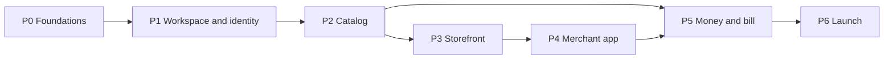

# Roadmap

> Part of the StartLite docs. Start at [README](README.md).

- Each phase ships something a merchant can use.
- A phase starts only when the last one passes its exit criteria.
- Every phase updates the documents it changes.

## Principles

1. Each phase ships a working slice. No phase is a layer with no visible result.
2. A phase starts only when the previous phase meets its exit criteria.
3. The schema is stable after P0. Later phases add columns, not rewrites.
4. Every phase updates the documents it changes in the same pull request.
5. Frictionless first. A merchant can record a real sale before creating an
   account. Login only saves, syncs, and unlocks the public surfaces.

## Phase overview

| Phase | Goal | Exit criterion |
|---|---|---|
| P0 | A deployable skeleton with tenancy | RLS test passes in CI |
| P1 | The daily loop works before login, and a merchant can save it | A guest sale survives signup with server-recomputed totals |
| P2 | A merchant can publish a catalog | Public API returns options and extras |
| P3 | A buyer can order through WhatsApp | A pending order is accepted with correct totals |
| P4 | The daily merchant loop works | A sale, payment, and bill run on a 360 px screen |
| P5 | Money and bills are correct everywhere | Totals match across database, API, UI, CSV, and PNG |
| P6 | Launch | Every gate in [Definition of Done](#definition-of-done) passes |

## P0 — Foundations

**Deliverables**

- Repository, `pnpm`, TypeScript strict, ESLint, Prettier.
- Vitest for unit tests, Playwright end-to-end, a 360 × 800 project.
- Docker Compose for local Postgres 18.
- Drizzle schema for every v1 table. Generated migration reviewed by hand.
- Postgres roles `startlite_app`, `startlite_admin`, `startlite_migrator`. RLS on
  every tenant table.
- `lib/tenant.ts` transaction wrapper. RLS isolation test.
- Design tokens, Tailwind theme, base layout, safe-area handling.
- GitHub Actions: lint, typecheck, unit, integration, build.
- Dockerfile using Next.js standalone output.
- Traefik router labels and the local Traefik instance.

**Exit criteria**

- `pnpm build` passes from a clean clone.
- The RLS test proves cross-tenant reads, updates, and deletes return zero rows.
- A demo page renders the token palette at 360 px.
- `https://startlite.test` reaches the app through Traefik.

## P1 — Workspace and identity

**Deliverables**

- Signed-out workspace at `/`. Five tabs, local storage, and a working sale,
  payment, expense, bill, and customer list with no account.
- `lib/guest-store.ts`: local state, integer paise, damaged-record cleanup, and an
  import payload.
- `components/guest/*`: the same daily loop as the merchant app.
- Save card that leads to signup. Onboarding prefills from the phone.
- `POST /api/v1/merchant/import`: server recomputes every total, dedupes by order
  code, and writes items, customers, orders, lines, payments, and expenses.
- Better Auth: sign up, sign in, sign out, password reset through Resend.
- Email OTP at signup, password reset, and a new device only.
- Onboarding in four screens and six fields: account, shop name, pack, category,
  WhatsApp number, UPI ID.
- Handle generated from the shop name, editable once. Reserved words blocked.
- `GET /api/v1/merchant/bootstrap`.
- Owner admin shell at `/admin` with a role check.
- Pass activation for 90 days. GST invoice from `platform_settings`, serial
  increment, and `audit_log`.
- Account suspension.

**Exit criteria**

- A first-time visitor records a sale and copies a bill without signing in.
- A guest sale imports after signup with totals the server recomputes.
- A repeated import skips the order instead of duplicating it.
- Clearing the phone copy happens only after a successful import.
- A new merchant reaches a live storefront in under 10 minutes.
- The owner activates a pass and the storefront status changes.
- A non-admin session receives `403` on every admin route.
- Password reset mail arrives through Resend.

## P2 — Catalog and media

**Deliverables**

- Item create, edit, soft delete. Three fields to publish: name, price,
  availability.
- Options and extras, two levels only. Option sets the price, extra adds a delta.
- One-tap availability toggle at item, option, and extra level.
- Item prompt and WhatsApp media flag.
- Media upload, local storage, and variant generation. Logo and one image per
  item.
- Store settings: notice banner, time slots, advance text, address placeholder,
  privacy mode, locale.
- Category pack defaults applied at onboarding: tab noun, starter items, unit
  labels.

**Exit criteria**

- The public catalog endpoint returns items with nested options and extras.
- Editing an option price does not change any `order_items` row.
- An uploaded image is served from `/media/{key}` in WebP and AVIF.
- A sold-out item stays visible and cannot be added to a cart.
- A new shop in any pack starts with at least three starter items.

## P3 — Storefront and pending orders

**Deliverables**

- `/b/[handle]` server-rendered page with metadata, Open Graph, and
  `LocalBusiness` JSON-LD.
- Tag cache with invalidation on catalog and availability writes.
- Filters: All, Products, Services.
- Option sheet with live price, extra deltas, and the item prompt.
- Cart, decimal quantity where allowed, floating cart bar.
- Checkout: name, phone, note, needed-by pills defaulting to Today, optional time
  slot, advance badge.
- Turnstile in managed mode on submit.
- `POST /public/orders` writes a pending order with a price snapshot and returns a
  10-character code.
- `wa.me` message with a short order summary and `/o/{code}`.
- `/o/[code]`: session check, shop match, review sheet with current price beside
  the snapshot, accept or decline.
- Nightly deletion of expired pending orders.

**Exit criteria**

- A buyer sends an order in under 60 seconds on a 360 px screen.
- The order message contains no prices beyond the total and the item count.
- A merchant taps the link and sees the review sheet in under 2 seconds.
- Accepting twice returns the first order and saves one.
- A tampered or unknown code returns `404`.
- A pending order older than 7 days is gone from the table.
- The storefront shows a paused page when the pass expires.

## P4 — Merchant app

**Deliverables**

- Five tabs: Home, Sales, Customers, the pack noun, More.
- Home shows three numbers, each with a period: Today's sales, Received today,
  Pending across all open orders.
- Quick actions: add sale, share store link, send bill.
- Pending-order strip with a review action.
- Sales list with All, Pending, and Paid filters.
- Order detail: add item, extra or discount, progress note, follow-up date,
  status change.
- Payment sheet with installments, partial payments, and the hidden TDS link.
- Customers sorted by pending amount. Repeat last bill. Payment reminder.
- Opening dues: add a previous due from paper in three fields.
- TanStack Query with `refetchOnWindowFocus`. Optimistic writes with rollback.
- Follow-up strip for orders due today.

**Exit criteria**

- The full daily loop runs on a budget Android profile with no jank.
- A walk-in sale saves in three taps.
- A failed write rolls back and shows a useful toast.
- Repeat last bill creates a new order with paid amount zero.
- A previous due appears in Customers and accepts a payment.

## P5 — Money and bill

**Deliverables**

- Merchant bill numbering per shop, assigned on the first bill. Not a GST invoice.
- Text bill compiler. Exact template in
  [design-system.md](design-system.md#bill-and-message-text).
- Reminder text for a due bill.
- Receipt PNG on the client, shared as a document.
- Deposits and reimbursements in totals, bill, and export.
- TDS logging and settlement.
- Cash left: payments on revenue lines minus expenses, inside More → Money.
- CSV export with a UTF-8 byte order mark, streamed, allowed on an expired pass.
- Pass expiry behavior across storefront, app, and export.

**Exit criteria**

- Totals agree across the database, API, interface, CSV, and PNG for ten seeded
  orders.
- A bill with a deposit and a reimbursement shows correct revenue and cash left.
- The bill text fits one WhatsApp message for a 20-line order.
- The QR appears only when an amount is due, and encodes the total only.
- Export works on an account with an expired pass.
- Option independence test passes.

## P6 — Launch

**Deliverables**

- Six live locales: `en`, `hi`, `hi-Latn`, `mr`, `gu`, `ta`. Eighteen beta locales
  with a report link.
- RTL support and script-specific font loading.
- PWA manifest, service worker, install flow, offline read fallback.
- Accessibility pass with TalkBack on the four primary flows.
- Performance budgets enforced in CI.
- Load test against the scale model in [architecture.md](architecture.md#scale-model).
- Backup restore drill, recorded.
- Legal pages: terms, privacy, refund, data deletion.
- Support through WhatsApp.
- Analytics for the metrics in [product.md](product.md#success-metrics).

**Exit criteria**

- Lighthouse mobile performance is 90 or higher on the storefront.
- No horizontal scroll at 320 px, 360 px, or 430 px.
- Restore completes in under 60 minutes.
- Every item in the Definition of Done is checked.

## After v1

| Item | Trigger |
|---|---|
| Razorpay and automated billing | 500 paying merchants, or 20 manual activations per week |
| Staff accounts | First paying merchant request |
| Custom domain per shop | 1,000 paying merchants |
| Field-level encryption | 1,000 paying merchants |
| Managed Postgres with point-in-time recovery | 5,000 paying merchants |
| Charts and trends | Only if merchants ask. Still not before 5,000. |

Automated billing waits for 500 merchants because annual prepay volume at that
scale still fits one weekly batch. The math is in [economics.md](economics.md).

## Definition of Done

- [ ] RLS isolation test passes. Cross-tenant read, update, and delete return zero rows.
- [ ] Raw `SELECT` on `orders`, `customers`, and `pending_orders` shows only the current tenant's rows.
- [ ] Money tests pass with `decimal.js`. No float appears in a calculation path.
- [ ] Option independence test passes. A catalog edit never changes `order_items`.
- [ ] A pending order is deleted on accept, on decline, and after 7 days.
- [ ] A pending order over 32 KB or 50 lines is rejected.
- [ ] A repeated accept returns the first order and writes nothing.
- [ ] Buyer checkout requires name and phone only. No login, OTP, or password.
- [ ] Checkout defaults needed-by to Today in one tap.
- [ ] The bill text matches the golden file for three seeded orders.
- [ ] The QR appears only on a bill with an amount due, and carries the total only.
- [ ] Cash left equals revenue payments minus expenses for the seed data.
- [ ] Export works on an expired pass.
- [ ] `tsc --noEmit`, `pnpm lint`, and every test suite pass.
- [ ] Lighthouse mobile performance is 90 or higher. LCP is under 2.5 s on Slow 4G.
- [ ] No horizontal scroll at 320 px, 360 px, or 430 px.
- [ ] Tap targets are at least 44 px. Contrast passes 4.5:1.
- [ ] Six live locales render without clipping. RTL locales mirror correctly.
- [ ] The PWA installs and opens in standalone mode.
- [ ] Rate limits are active on auth, public order, and public storefront paths.
- [ ] Turnstile blocks a scripted submit.
- [ ] Security headers are present on every response.
- [ ] A backup restore has been performed in the last 90 days.
- [ ] Sentry captures errors with PII redacted. `/api/health` reports the build SHA.

## Test gates

| Gate | Tool | Blocks merge |
|---|---|---|
| Types | `tsc --noEmit` | Yes |
| Lint and format | ESLint, Prettier | Yes |
| Unit: money, pending code, UPI, bill text | Vitest | Yes |
| Integration: RLS, order totals, accept, idempotency | Vitest with a test database | Yes |
| End-to-end: signup, catalog, order, accept, bill, export | Playwright, 360 × 800 | Yes |
| Accessibility | axe on four flows | Yes |
| Performance budget | Lighthouse CI | Yes |
| Dependency audit | `pnpm audit` | Weekly |

## Risks

Technical and security risks live in [architecture.md](architecture.md#accepted-risks).
This table covers delivery risk only.

| Risk | Impact | Mitigation | Trigger to act |
|---|---|---|---|
| Scope creep from the capability map | High | Exit criteria and the guardrails in [product.md](product.md#guardrails) | Any unplanned feature |
| Pending orders become a spam target | Medium | Turnstile, rate limits, 32 KB cap, login to read | Abuse in the log |
| Short codes are guessed | Low | 50 random bits, login, shop match, 7-day expiry | Any hit from a wrong shop |
| GST invoice format is wrong | Medium | Accountant review of one sample invoice | P1 |
| Twenty-four locales become unmaintainable | Medium | Six live, eighteen beta, one file per locale | Every new string |
| Postgres grows past the disk | Low | Indexes, archive policy, disk alert at 70% | 60% disk |
| Manual activation cannot keep up | Medium | Weekly batch, then Razorpay at 500 merchants | 20 activations per week |
| Card or bank apps reject large QR scans | Low | Copy UPI ID and open-app fallback above ₹2,000 | Any merchant report |

## Scope boundary

The v1 boundary is defined in [product.md](product.md#scope-boundary). Anything
outside it needs a decision in [decisions.md](decisions.md) before work starts.
